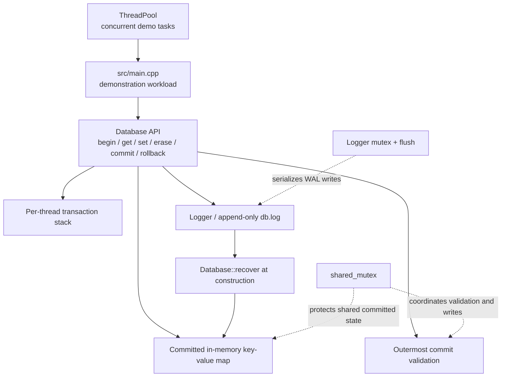
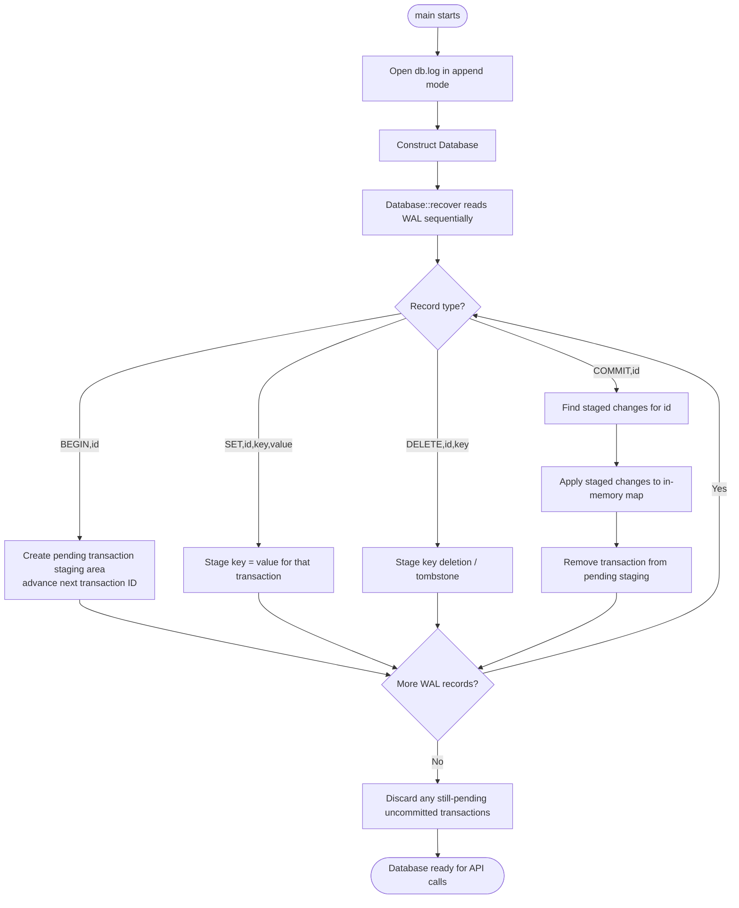
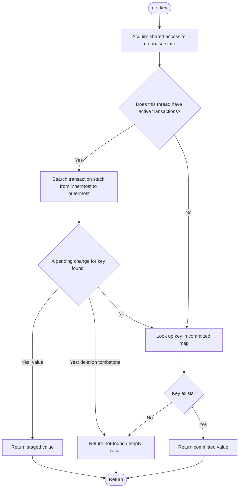
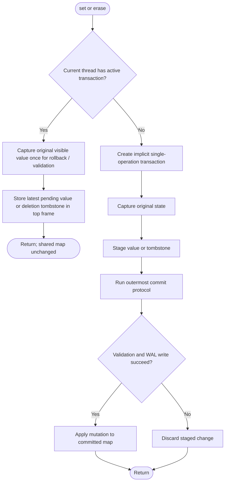
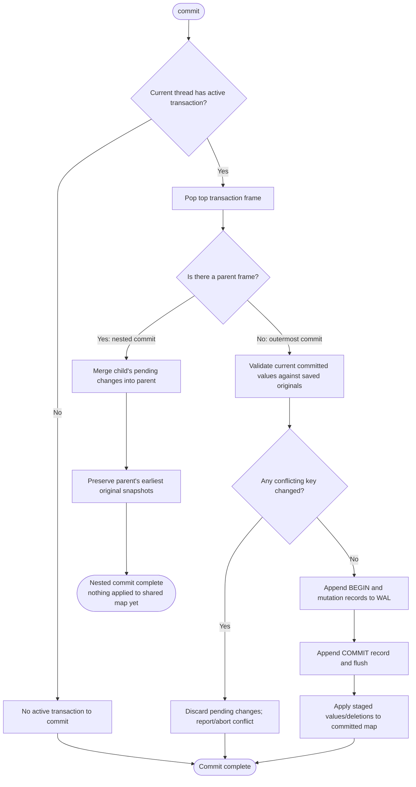
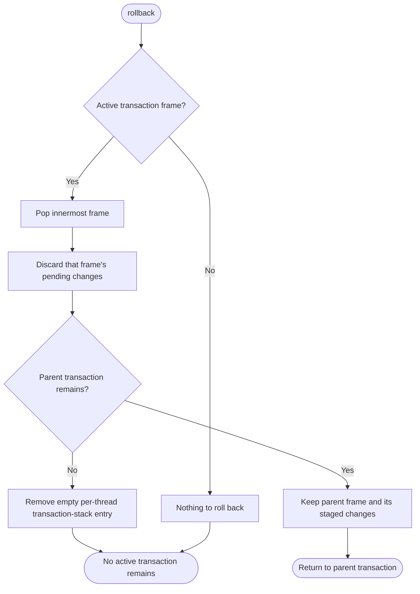
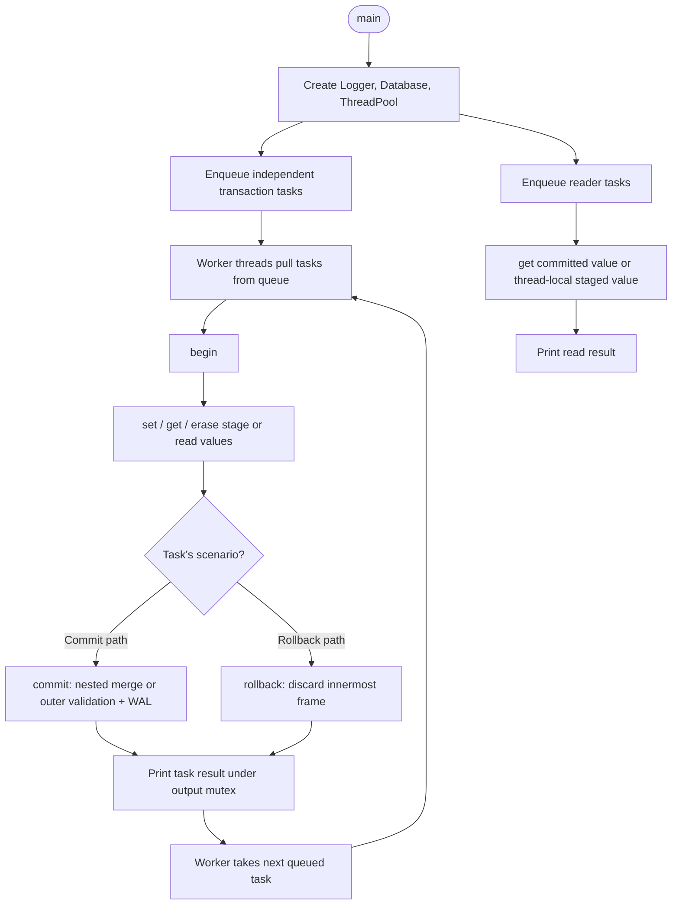
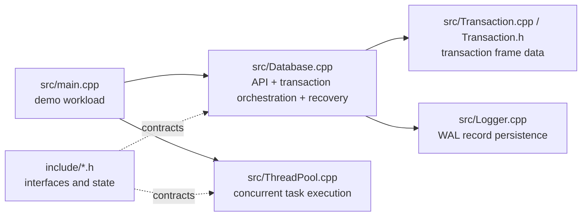

# Project Flowchart — `MiniDB`

These diagrams explain the **implemented control flow**.

## How to read this
- **Rectangle**: operation / component.
- **Diamond**: decision.
- **Solid arrows**: normal control or data flow.
- The Mermaid diagrams render on GitHub and in VS Code with a Mermaid preview extension.
- Start with each project's **big picture**, then follow the request/transaction flow.

---

# `MiniDB`

## 1. Big-picture architecture

**Mental model:** each thread gets its own stack of transaction frames. Writes are staged in a transaction's pending changes; reads check the current thread's nested frames before committed data. An outermost commit validates the original values, records the commit in the WAL, and then applies the changes to memory.

## 2. Startup and crash recovery

**Why the WAL matters:** committed records can rebuild the in-memory map after restart. A transaction without a `COMMIT` record remains staged and is not applied. `DELETE` must replay as an actual erase so deleted keys do not reappear.

## 3. `get(key)` — read-your-own-writes

A transaction sees its own staged updates, including updates in nested frames, without exposing those uncommitted values to other threads.

## 4. `set(key, value)` and `erase(key)`

`set` and `erase` share the transaction machinery. A standalone mutation is treated as a small transaction rather than bypassing commit logic.

## 5. `commit()` — nested versus outermost transaction

**Critical concept:** a nested commit is a merge into its parent savepoint, not a durable database commit. Only the outermost frame validates and publishes changes to the shared map.

## 6. `rollback()` — nested savepoint behavior

Rollback is scoped to the current thread's innermost transaction.

## 7. Concurrency and task execution

The current `main.cpp` is a concurrency demonstration: it queues transaction tasks and reader tasks on a worker pool. It is not a command-line database shell.

## 8. Source-file responsibility map

---

# Suggested reading order

1. `src/main.cpp` — see the actual workload and concurrency setup.
2. `include/Database.h` and `include/Transaction.h` — understand state and transaction frames.
3. `src/Database.cpp` — follow `get`, `set`, `erase`, `begin`, `commit`, `rollback`, and `recover`.
4. `src/Logger.cpp` — WAL append and flush behavior.
5. `src/ThreadPool.cpp` — how concurrent tasks are scheduled.
6. `docs/TRANSACTION_INTERNALS.md` and `docs/WAL_RECOVERY.md` — use these as supporting explanations.

## Important interpretation note
- These are **code-understanding flowcharts**, not a certification that every advertised property is fully correct under every failure mode.
